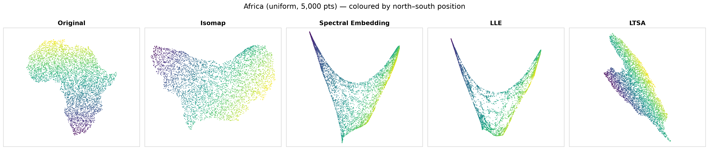
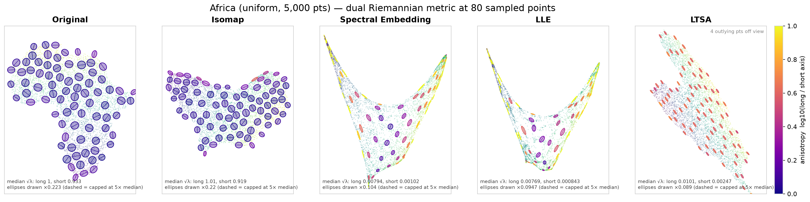

# Manifold Learning

Exploring how non-linear dimensionality reduction (manifold learning) algorithms
recover — or distort — the hidden geometry of data. The project compares
**Isomap**, **Spectral Embedding (Laplacian Eigenmaps / Diffusion Maps)**,
**Locally Linear Embedding (LLE)** and **LTSA** on datasets with known geometry
(the Africa and Americas landmasses, the Stanford Bunny), and is moving toward
higher-dimensional real data such as GloVe word embeddings.

Guiding questions:

- When is each algorithm the right choice, and which are most prone to artifacts?
- How can the Riemannian metric be used to measure how an embedding stretches or
  shrinks the data locally?
- What geometric structure is hidden in complex datasets like word vectors?

## Results so far

Full write-ups, with every figure explained: **[docs/results/](docs/results/README.md)**
([Africa](docs/results/africa.md) · [Americas](docs/results/americas.md) ·
[Bunny](docs/results/bunny.md) · [GloVe](docs/results/glove.md))

**Embeddings.** Africa (2D, 5,000 area-uniform points), coloured by north–south position:



**Local distortion via the dual Riemannian metric.** Each ellipse shows how the
embedding stretches (long axis) or shrinks (short axis) the data at that point. A
circle means no distortion:



| Median stretch ratio (1.0 = shape preserved) | Africa | Americas | Bunny |
|---|---:|---:|---:|
| Isomap | **1.10** | 3.65 | **1.55** |
| Spectral Embedding | 5.58 | 33.7 | 3.42 |
| LLE | 8.21 | 118 | 2.98 |
| LTSA | 4.07 (one global linear map) | **3.75** (global) | 2.88 |

## Repository layout

```text
manifold-learning/
├── scripts/
│   ├── run_africa_benchmark.py   megaman: 4 algorithms on the Africa dataset
│   ├── run_bunny_benchmark.py    megaman: 4 algorithms on the Stanford Bunny
│   ├── riemannian_metric.py      embeddings + dual Riemannian metric ellipses, all datasets
│   ├── parameter_sweep.py        same, for k = 8/16/32 × three kernel radii per dataset
│   └── megaman_smoke_test.py     minimal check that megaman is installed
├── glove/                        convert + load GloVe vectors (see glove/README.md)
├── notebooks/                    scikit-learn / UMAP warm-ups: swiss roll, s-curve, digits, iris
├── results/                      generated figures and metric tables, per dataset
├── docs/results/                 results write-ups (one page per dataset)
├── docs/notes/                   research notes (algorithm summaries, progress, open questions)
├── data/                         datasets — local only, not committed
└── requirements.txt
```

## Setup

```bash
python -m venv .venv
source .venv/bin/activate
pip install -r requirements.txt
pip install cython && pip install git+https://github.com/mmp2/megaman.git
```

[megaman](https://github.com/mmp2/megaman) predates current NumPy/SciPy, so the
scripts patch `np.float`, `scipy.linalg.solve(sym_pos=...)` and `scipy.linalg.eigh(eigvals=...)`
at import time (tested with Python 3.11, NumPy 2.4, SciPy 1.17).

## Data

Datasets are **not included** in this repository. Scripts expect them under `data/`:

| Path | Contents | Source |
|---|---|---|
| `data/africa/uniform_5000/` | 5,000 area-uniform mainland points (N×2, units of 1,000 km) | Natural Earth land/country shapefiles |
| `data/americas/{uniform,balanced,combined_10,combined_20}_5000/` | Four sampling profiles of the American mainland | Natural Earth |
| `data/bunny/` | 5,000 area-uniform surface samples (N×3, normalized) | [Stanford Bunny](https://graphics.stanford.edu/data/3Dscanrep/) |
| `data/glove/` | GloVe 6B 50d vectors converted to `.npy` | [Stanford GloVe](https://nlp.stanford.edu/projects/glove/) |

## Running

From the repository root:

```bash
python scripts/run_africa_benchmark.py   # writes results/africa/
python scripts/run_bunny_benchmark.py    # writes results/bunny/
python scripts/riemannian_metric.py      # all datasets -> results/<dataset>/riemannian/ (~10 min)
python scripts/riemannian_metric.py africa bunny   # or a subset
python scripts/parameter_sweep.py        # k × r sweep -> results/<dataset>/experiments/
```

Sweep results: every `(k, r)` setting and its figures are listed in the
per-dataset tables linked from [results/README.md](results/README.md).

## Notes

Research notes live in [`docs/notes/`](docs/notes/):

- [Dimension reduction from the user's perspective](docs/notes/dimension-reduction-users-perspective.md) — when to use manifold learning, algorithm walkthroughs, distortions
- [Work completed](docs/notes/work-completed.md) — progress log, next steps and open questions
