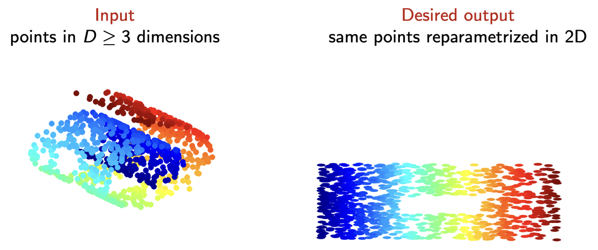

## section 1: when to do (non-linear) dimensional reduction
- big, high dimensional data
- data/physics support manifold models
- understanding > prediction

- high dimensional data `p ∈ ℝ^D, D = 64x64`
- can be described by a small num (`d`) of continuous params
- usually large sample size (`n`)

- turns `nxD` to `nxs` where `s << D`
	- saves space+computation
- preserve large scale features, suppress small scale features
	- understanding ++ perhaps prediction tasks
---
## section 2: manifold learning algorithms

- swiss roll example

- ML algos start with a **neighbourhood graph** over data points
---
#### Isomap Algorithm

**Input:** Graph distance matrix $A$, target dimension $d$

1. **Compute Shortest Paths:** Find all shortest path distances in the neighborhood graph.
    - If $A_{ij} = \infty \implies A_{ij} \gets \text{graph distance between } i, j$.
2. **Construct Squared Distance Matrix:** Create matrix $M = [(A_{ij})^2]$.
3. **Apply MDS:** Use Multi-Dimensional Scaling $\text{MDS}(M, d)$ to obtain $d$-dimensional coordinates $Y$ for $\mathcal{D}$.

Note: Works also for $m > d$.

**Intuitively:** Standard distance metrics (like straight-line Euclidean distance) fail on curved datasets (imagine a rolled-up piece of paper or a "Swiss roll") because a straight line might cut through empty space rather than following the actual shape of the data. 

Isomap fixes this by only connecting nearby points, creating a web (neighborhood graph). By calculating the shortest path through this web (Step 1), it measures distances _along the surface_ of the data. Once it has these "true" surface distances (Step 2), it hands them off to MDS (Step 3), which is an algorithm that flattens out the data into $d$ dimensions while trying to keep those original surface distances exactly the same.

---
#### Diffusion Maps (DM) / Laplacian Eigenmaps (LE) Algorithm

**Input:** Distance matrix $A \in \mathbb{R}^{n \times n}$, bandwidth $\epsilon$, embedding dimension $m$.

1. **Compute Laplacian:** Calculate the Laplacian matrix $L \in \mathbb{R}^{n \times n}$. _(See the sub-routine below)_.
2. **Compute Eigenvectors:** Find the eigenvectors of $L$ corresponding to the smallest $m+1$ eigenvalues: $[\phi_0, \phi_1 \dots \phi_m] \in \mathbb{R}^{n \times m}$.
    - Discard $\phi_0$ because it is constant and not informative.
3. **Get Coordinates:** The new embedding coordinates for a point $p_i$ are $(\phi_{i1}, \dots \phi_{is})$.

##### Sub-Routine: The (Renormalized) Laplacian

**Input:** Distance matrix $A \in \mathbb{R}^{n \times n}$, bandwidth $\epsilon$.

1. **Compute similarity matrix:** $S_{ij} = \exp\left(-\frac{A_{ij}^2}{\epsilon^2}\right) = \kappa(A_{ij}/\epsilon)$.
2. **Normalize columns:** Calculate column sums $d_j = \sum_{i=1}^n S_{ij}$, then divide to get $\tilde{L}_{ij} = S_{ij}/d_j$.
3. **Normalize rows:** Calculate row sums $d'_i = \sum_{j=1}^n \tilde{L}_{ij}$, then divide to get $P_{ij} = \tilde{L}_{ij}/d'_i$.
4. **Calculate L:** Compute the final Laplacian as $L = \frac{1}{\epsilon^2}(I - P)$.
5. **Output:** Return $L$ and the ratio $d'_i/d_i$.

**Key Notes on the Laplacian:**

- The Laplacian $L$ is central to understanding the geometry of the manifold.
- As the number of points grows ($\lim_{n \to \infty}$), $L$ converges to the Laplace-Beltrami operator $\Delta_{\mathcal{M}}$.
- The "renormalization trick" (Steps 2 & 3) cancels out errors caused by non-uniform sampling density (i.e., when some areas of your dataset have clustered points and others are sparse).
    
- **Other Laplacian formulas**:
    - Unnormalized: $L^{un} = \text{diag}\{d_{1:n}\} - A$
    - Random walk: $L^{rw} = I - \text{diag}\{d_{1:n}\}^{-1}A$
    - Normalized: $L^n = I - \text{diag}\{d_{1:n}\}^{-1/2}A\text{diag}\{d_{1:n}\}^{-1/2}$

**Intuitive Explanation:**

Think of this algorithm as modeling ink diffusing through water, or a random walk across a web of data points.

1. **The Similarity Matrix ($S_{ij}$):** This converts strict distances into "probabilities." Points that are very close get a high score (near 1), and points far away get a low score (near 0). The bandwidth $\epsilon$ acts as a threshold for what counts as "close."
2. **The Laplacian ($L$):** By normalizing these scores across rows and columns, you create a matrix that perfectly describes how easily you could "hop" from one point to any other point. The renormalization steps ensure that dense clusters of data don't artificially act like black holes that trap the random walk.
3. **The Eigenvectors ($\phi$):** In linear algebra, eigenvectors find the principal axes of a matrix. By taking the eigenvectors of the Laplacian, you are essentially extracting the main "highways" of how information flows through your data. These highways become your new, simplified $d$-dimensional coordinates.

---
#### t-Stochastic Neighbor Embedding (t-SNE)

**Input:** Similarity matrix $S$, target embedding dimension $s$. **Initialization:** Choose starting embedding points $y_{1:n} \in \mathbb{R}^s$ at random.

1. **Normalize Input Probabilities:** Set self-similarity to zero ($S_{ii} \gets 0$). Normalize the rows by calculating $d_i = \sum_j S_{ij}$, then compute $P_{ij} = S_{ij}/d_i$.
2. **Symmetrize Distribution:** Compute symmetric probabilities $P = \frac{1}{2n}(P + P^T)$.
    - $P$ acts as a joint probability distribution over pairs of neighbors $(i,j)$ in the original high-dimensional space.
3. **Compute Output Space Similarity:** Calculate similarities in the new low-dimensional space using $\tilde{S}_{ij} = \tilde{\kappa}(\vert{}\vert{}y_i - y_j\vert{}\vert{})$.
    - Uses the Cauchy distribution (Student-t with 1 degree of freedom): $\tilde{\kappa}(z) = \frac{1}{1+z^2}$.
4. **Define Output Distribution:** Construct distribution $Q$ such that $Q_{ij} \propto \tilde{S}_{ij}$.
5. **Optimize:** Adjust coordinates $y_{1:n}$ via gradient descent to decrease the Kullback-Leibler (KL) divergence: $KL(P\vert{}\vert{}Q) = \sum_{i,j} P_{ij} \ln \frac{P_{ij}}{Q_{ij}}$. Repeat from Step 1.

notes
- repulsion-based (heuristic) algorithm
- very useful for visualizing data
	- repulsion mechanics encourage cluster formation
- non-deterministic (due to random initialization)
	- involves tuning more parameters than other methods.

**Intuitive Explanation:**

t-SNE is essentially a matchmaking algorithm that tries to preserve local neighborhoods. First, it looks at your high-dimensional data and calculates the probability that any two points are "neighbors" (the $P$ distribution).

Next, it throws those points randomly onto a flat 2D or 3D canvas and calculates the neighbor probabilities _there_ (the $Q$ distribution). The algorithm's goal (Step 5) is to nudge the points around on the canvas until the canvas probabilities ($Q$) match the original probabilities ($P$) as closely as possible.

The "secret sauce" is the Student-t distribution in Step 3. Standard normal distributions have thin tails, meaning points that are moderately far apart pull on each other like springs, causing "crowding" in the middle of the canvas. The Student-t distribution has "heavy tails," which acts as a repulsive force. It allows points that are dissimilar in the original space to be pushed much further away from each other on the canvas without breaking the math. This repulsion is why t-SNE creates such beautifully separated, distinct clusters for visualization.

---

**UMAP (Uniform Manifold Approximation and Projection)**

**Input:** $k$ (number of nearest neighbors), target dimension $d$.

1. **Find Neighbors:** Find the $k$-nearest neighbors for each data point.
2. **Construct Asymmetric Similarities:** Create weights $w_{ij}$ such that the sum over neighbors equals a constant: $\sum_j w_{ij} = \log_2 k$. Form the matrix $W = [w_{ij}]$.
3. **Symmetrize:** Compute the symmetric similarity matrix $S = W + W^T - W .* W^T$.
4. **Initialize:** Initialize the low-dimensional embedding $\phi$ using the Laplacian Eigenmaps algorithm.
5. **Optimize:** Iteratively optimize the embedding for $n_{iter}$ steps by applying attractive and repulsive forces:
    - Sample an edge $ij$ with probability proportional to $\exp(-d_{ij})$.
    - Move point $\phi_i$ towards $\phi_j$ (attraction).
    - Sample a random point $j'$ uniformly.
    - Move point $\phi_i$ away from $\phi_{j'}$ (repulsion).
    - Note: This optimization process acts as a stochastic approximate logistic regression of $\vert{}\vert{}\phi_i - \phi_j\vert{}\vert{}$ on the high-dimensional distance $d_{ij}$.

**Output:** Final low-dimensional embedding coordinates $\phi$.

**Intuitive Explanation:**

UMAP is essentially a modern, often faster alternative to t-SNE that is better at preserving the "big picture" (global structure) of your data, not just local clusters.

- **The Fuzzy Graph (Steps 1-3):** UMAP connects points to their $k$-nearest neighbors to build a web. The weights ($w_{ij}$) drop off as distances increase, creating a "fuzzy" topological representation of the data. The symmetrization step (using $W .* W^T$, which represents a fuzzy set union) ensures that the connections between points agree with each other mathematically.
- **The Head Start (Step 4):** This is UMAP's secret weapon. While t-SNE throws points randomly onto the canvas to start, UMAP uses Laplacian Eigenmaps (the algorithm from your previous slide!) to establish the initial layout. This gives the algorithm a massive head start on understanding the global shape of the dataset.
- **Push and Pull (Step 5):** The optimization uses a technique similar to negative sampling in machine learning. It acts like springs and magnets. If two points share an edge in the high-dimensional graph, UMAP pulls them together on the canvas. To prevent all the points from collapsing into a single dot, it randomly picks unconnected points and pushes them away from each other.

---
### summary

---
**e-vector based**
- diffusion maps
- isomap

- well studied, params better understood ✅
- collapsed embeddings ❌
	- "horseshoes" possible
	- straight-line sequence of data bent into a U-shape when visualized in lower dimension

- requires embedding dimension $s>=d$
---
**repulsion based**
- t-SNE
- UMAP

- heuristic, more parameters ❌
- no collapsed embeddings ✅

- $s=d$ intrinsic dimension
---
- embedding algos almost always distort the shape of data

## section 3: the sandwich -> distortions, artefacts, parameters

- sandwich:
	- before embedding
	- G1 ML algorithm
		- cluster
		- estimate + correct distortion
		- validate d, s \[select eigenvectors\]
		- topological data analysis (TDA)
		- meaning of coords
	- after embedding

### distortions/failures/irreproducability
<!-- TODO: add missing image 'Screenshot 2026-10-05 at 12.44.14 PM.png' to images/ -->
- **fail to preserve neighborhoods**: LLE, Diffmaps, HE -> must diagnose
- **distortion**: Isomap (non-linear), LTSA (linear) -> must recognize equivalence, correct

ϕ **distorts** if distances, angles, density not preserved BUT **ϕ smooth and reversible**

ϕ **fails** if it does not preserve topology (=preserve neighborhoods)
- discontinuous deformation,
- non-invertible ϕ
- breaks/collapses neighborhoods
- collapse in dimension (local/global)

most common modes of failure
- distance matrix A does not capture topology (artificial "holes" or "bridges")
	- usually bc neighborhood is too small or large
- for e-vector based algorithms: choice of e-vectors

### artefacts
- features of an embedding that do not exist in the data (clusters, holes, "arms," "horseshoes")

things to beware of when computing an embedding
- algorithms that **claim** to chose $\epsilon$ automatically
- confirming the embedding is "correct" by visualization: tends to over smooth, i.e., $\epsilon$ over estimated
- K-nn (default in `sk-learn`) instead of radius neighbors: tends to create clusters
- large variations in density: subsample data to make it more uniform
- **"horseshoes"**: choose other e-vectors ($\phi$ is almost singulare)

- very popular heuristics: LLE, t-SNE, UMAP, neural networks are more prone to artefacts

