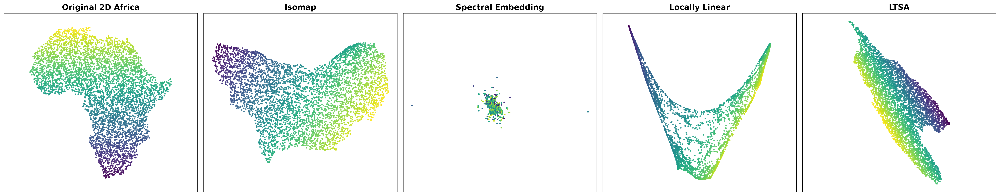
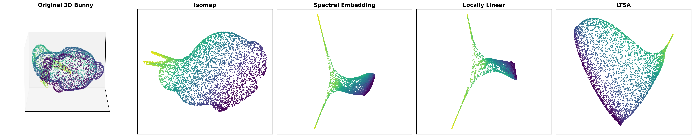

create some documents to record what you have achieved and the questions you have about the project for now

applying megaman algorithms on 2D Africa dataset:

applying megaman algorithms on 3D bunny dataset:

docsscreens, what input/output is what the fn is doing

try different k, different parameters, compare
draw the dual riemannian metric

plot feature vectors
sample only part of the dataset (few thousand, not beyond 10k)
plot ellipses/dual riemmanian metric

**questions**:

applications of each:
- when would we use each algorithm? like when would it be optimal to use isomap over spectral embedding vs LLE vs LTSA?
- or do we use all of them?

also check our proposal, like whats the research problem we're solving bc we need to write a proposal/paper? whats the goal of us doing this project?

choose a sample of points
- plot dual riemanian metrics
- expresses how it stretches / shrinks at that point

- eigenvectors 

---

apply different algorithms to different datasets
find geometry properties of this dataset
specific artifacts, 
which algorthims are more prone to artifacts
how studying riemannian metric

explore geometry of word2vec

**problem**:
how to find the hidden geometry of data -> using algorithms
investigating specific algorithms to find geometric properties of dataset
best/worst algorithms, common pitfalls

proposal solution: hidden geometry of specific datasets
using different complex datasets, word2vec, astronomy
