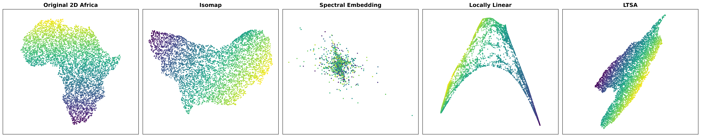
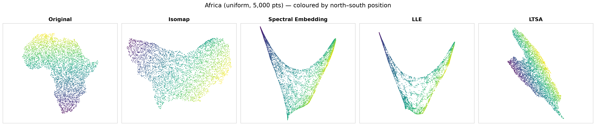
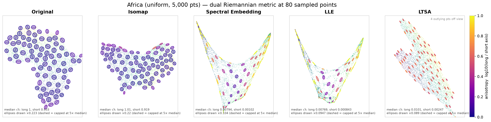
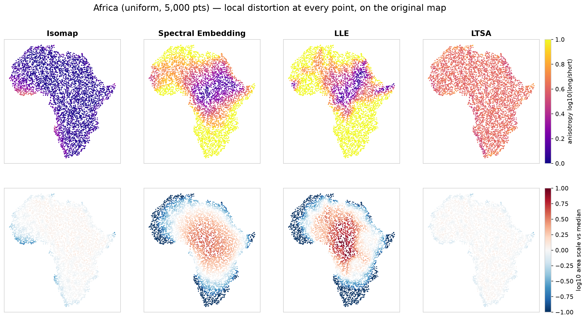
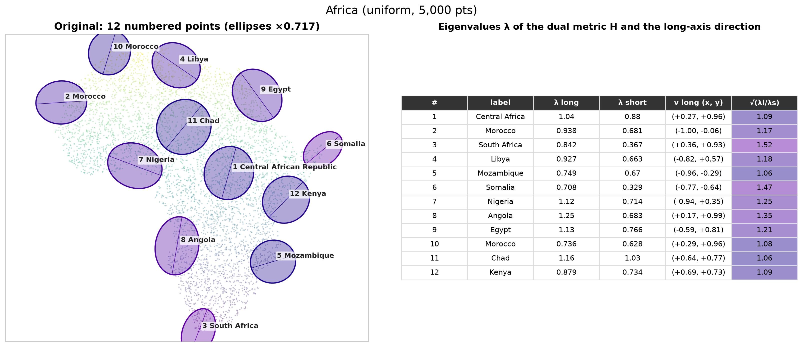
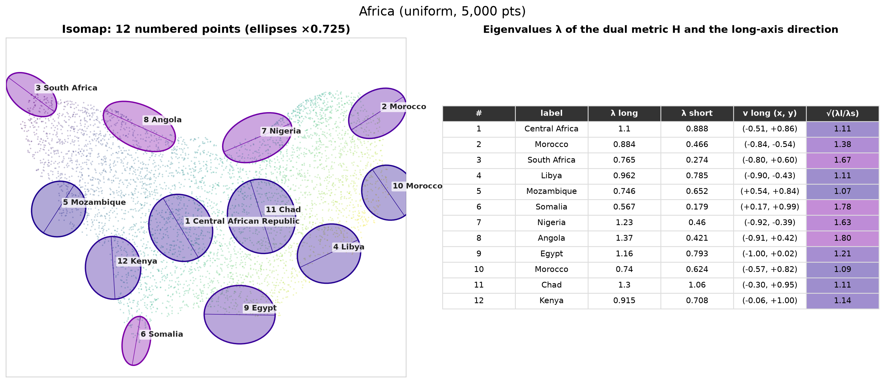
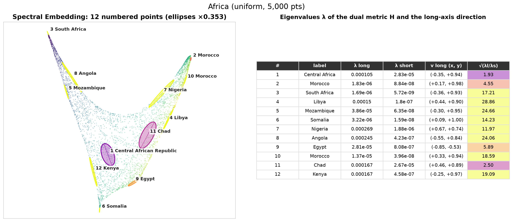
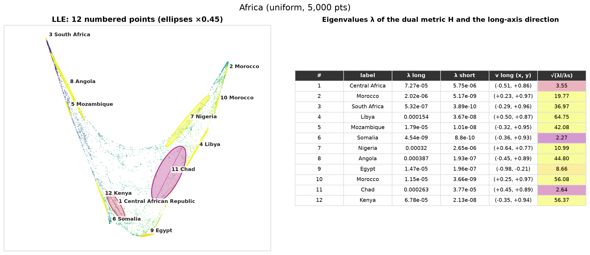
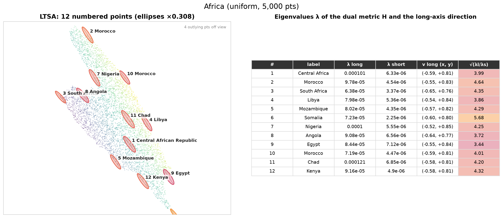

# Africa

5,000 points spread evenly by area over mainland Africa (Natural Earth, offshore
islands excluded), as a 2D map in units of 1,000 km. The data is already flat, so a
perfect method should give back Africa up to rotation and scale. Any distortion
comes from the algorithm.

[← all results](README.md)

## 1. First-pass comparison (`run_africa_benchmark.py`)

The original map and four megaman embeddings, coloured by north–south position.

- **Isomap** recovers a recognisable, rotated Africa: the horn and the Gulf of Guinea
  are visible, and the colour gradient is smooth.
- **Spectral Embedding** is a cloud of noise with a few far outliers. This is **not a
  property of the algorithm**. The script's radius (0.05) is smaller than the
  typical point spacing (~0.08), and the default eigen-solver mishandles megaman's
  non-symmetric geometric Laplacian. The corrected run is in section 2.
- **LLE** folds the continent into a "V": the south and the west become two thin arms.
- **LTSA** keeps the overall layout but shears it diagonally.

Individual high-resolution panels: [isomap](../../results/africa/isomap.png) ·
[spectral](../../results/africa/spectral_embedding.png) ·
[LLE](../../results/africa/locally_linear.png) · [LTSA](../../results/africa/ltsa.png) ·
[original](../../results/africa/original_2d_africa.png)

## 2. Embeddings with corrected settings

Same data, now with a kernel radius of 0.25 and the `lobpcg` solver for Spectral
Embedding. Spectral Embedding now gives a clean "U". It is ordered north (yellow, right
arm) to south (purple, left arm), but the continent is bent onto a curve, the classic
"horseshoe" artifact of Laplacian eigenmaps on elongated shapes. LLE gives a similar,
more extreme arch.

## 3. Dual Riemannian metric ellipses

`H` drawn at 80 evenly spread points (see [how to read these](README.md#method-the-dual-riemannian-metric)).

- **Original**: near-circles everywhere (median stretch ratio 1.07), which confirms the
  estimator works. The few elongated ellipses sit on the coastline.
- **Isomap**: also near-circles, nearly as good as the original. The only clearly stretched
  ellipses are on the outer edge of the shape, where the k-NN graph is one-sided.
- **Spectral Embedding**: round ellipses in the middle of the "U", thin yellow
  needles along both arms. Distances *along* the arms are kept while distances *across*
  them collapse.
- **LLE**: the same pattern, but stronger and with much larger changes in size between
  the middle and the arms.
- **LTSA**: every ellipse has almost the **same shape and orientation** (≈4:1, tilted
  the same way). This is the signature of a single global linear map.

## 4. Distortion at every point, on the original map

Each dot is a data point at its true position, coloured by what the embedding does
there. Top row: stretch ratio. Bottom row: area scale relative to the median (red =
enlarged, blue = shrunk).

- **Isomap** is uniformly dark (isotropic) and nearly white (constant area). Only the
  West African bulge and the southern tip show mild distortion.
- **Spectral Embedding and LLE** keep central Africa (Chad, CAR, Congo basin) nearly
  isotropic and enlarged. They squeeze North-West Africa and Southern Africa by more
  than 10× in one direction and shrink their area by more than 10×. The distortion
  grows with distance from the centre.
- **LTSA** has the same colour everywhere in both rows: a constant ≈4:1 stretch and a
  constant area. A global linear transformation would remove it.

## 5. Point-by-point detail

The same 12 points (labelled with their country) in each embedding, with the
eigenvalues of `H`, the long-axis eigenvector and the stretch ratio.

| | |
|---|---|
|  |  |
|  |  |
|  | |

- In **Original** both eigenvalues are ≈1. **Isomap** stays close: ratios are 1.1–1.8, and the largest are at the coast (Somalia, Angola, South Africa).
- In **LLE**, the ratio ranges from about 2 (Chad, Somalia) to about 65 (Libya), a
  30-fold change across one continent.
- In **LTSA**, every point has a ratio of about 4 and nearly the same eigenvector.

## 6. Numbers (`summary.csv`)

| Algorithm | median stretch ratio | 90th pct ratio | share of points with ratio > 2 | area-scale spread (p90/p10) |
|---|---:|---:|---:|---:|
| Original (noise floor) | 1.07 | 1.21 | 0% | 1.32 |
| Isomap | **1.10** | **1.41** | **3%** | 1.58 |
| Spectral Embedding | 5.58 | 18.6 | 86% | 33.3 |
| LLE | 8.21 | 43.1 | 91% | 101.6 |
| LTSA | 4.07 | 4.40 | 100% | **1.32** |

Per-point values for all 80 samples: [`samples.csv`](../../results/africa/riemannian/samples.csv).

**Conclusion.** On a flat, compact shape, Isomap is nearly an isometry. LTSA is exact up
to one linear map: its area spread equals the noise floor. Spectral Embedding and LLE
create distortion that varies from place to place and grows toward the boundary, so it
cannot be undone with a single transformation.
