# Americas

5,000 points on the American mainland as a 2D map (units of 1,000 km). The shape is
long, thin and joined by the narrow Central American isthmus, so it is much harder
than Africa for any method built on a neighbourhood graph. Two sampling profiles are
compared:

- **uniform_5000**: all points uniform by area. The isthmus gets very few points.
- **balanced_5000**: 90% uniform and 10% extra points on the isthmus, so the graph
  stays well connected through it.

[← all results](README.md)

## 1. Embeddings

**Uniform**

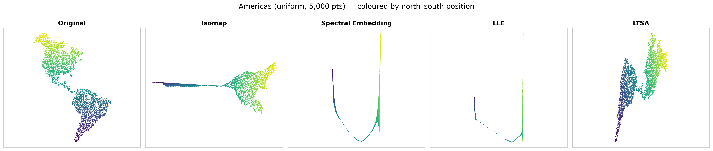

**Balanced**

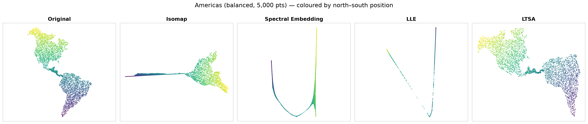

Coloured by north–south position (yellow = Alaska/Canada, purple = Patagonia).

- **Isomap** keeps North America as a 2D blob but **flattens South America into a
  thin line** that sticks out to the left. Shortest paths into South America all go
  through the isthmus, so their distances look "1D". The effect is stronger with the
  balanced profile.
- **Spectral Embedding** and **LLE** collapse the whole continent onto a 1D curve (a "U"
  or "V"), with each sub-continent becoming a thin needle. The north–south order
  survives, but east–west is lost.
- **LTSA** is the only method that keeps both continents as 2D shapes. With the
  **balanced** profile it gives an almost undistorted (mirrored and rotated) map.

## 2. Dual Riemannian metric ellipses

**Uniform**

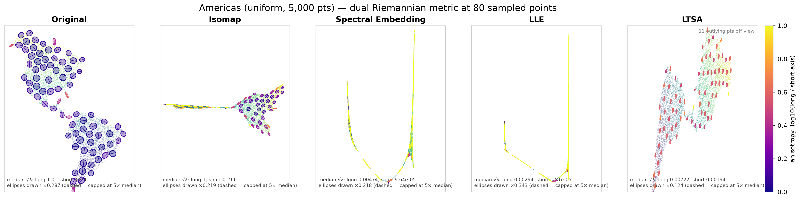

**Balanced**

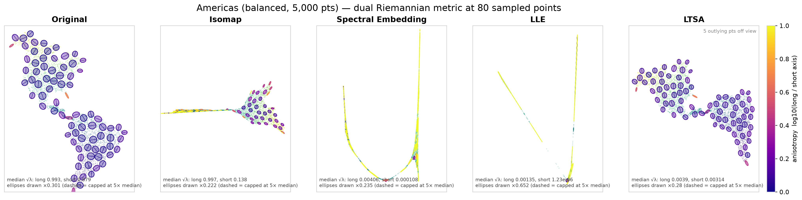

- **Original**: round ellipses everywhere (noise floor). The thin, elongated ones sit
  on narrow coastal strips and on the isthmus.
- **Isomap**: round ellipses in North America and needle-shaped ones (yellow/orange)
  along the South American "stick". South America keeps its north–south extent but
  loses its width.
- **Spectral Embedding / LLE**: almost every ellipse is a yellow needle along the
  curve, with stretch ratios of 30–400 (median). Many are capped (dashed).
- **LTSA**: identical, uniformly tilted ellipses. With the uniform profile they are
  ≈4:1 everywhere, a global shear. With the balanced profile they are nearly round
  (ratio 1.18): the best result of any method on the Americas.

## 3. Distortion at every point, on the original map

**Uniform**

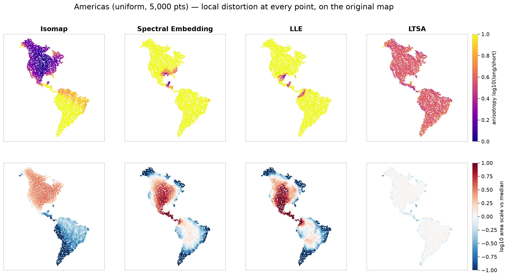

**Balanced**

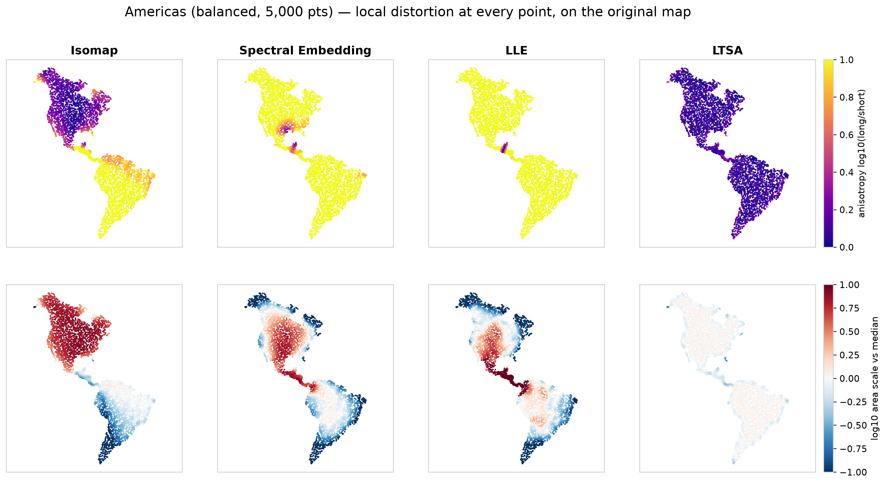

Top row: stretch ratio. Bottom row: area scale relative to the median (red = enlarged,
blue = shrunk).

- **Isomap**: North America is isotropic (dark). South America is bright yellow
  (more than 10:1) and blue (area shrunk 3–10×). The distortion switches on exactly at
  the isthmus.
- **Spectral Embedding / LLE**: almost the entire map is yellow. In the area row the
  interior of North America is enlarged, while the Arctic, Patagonia and the coasts
  are shrunk more than 10×. The few dark spots are where the curve bends: Mexico/Texas
  and Colombia/Panama.
- **LTSA**: one flat colour in both rows. Its distortion is purely global.

## 4. Point-by-point detail

Twelve numbered points, labelled with their country, plus their eigenvalues and
eigenvectors.

**Uniform**

| | |
|---|---|
| 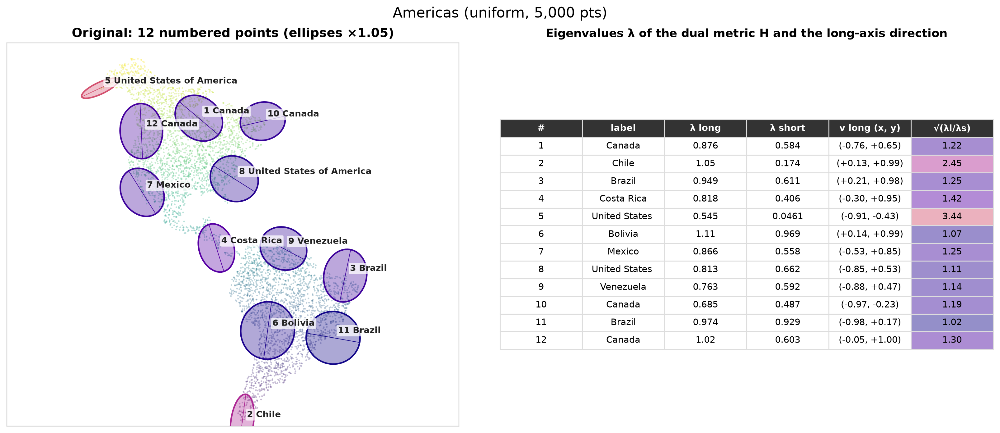 | 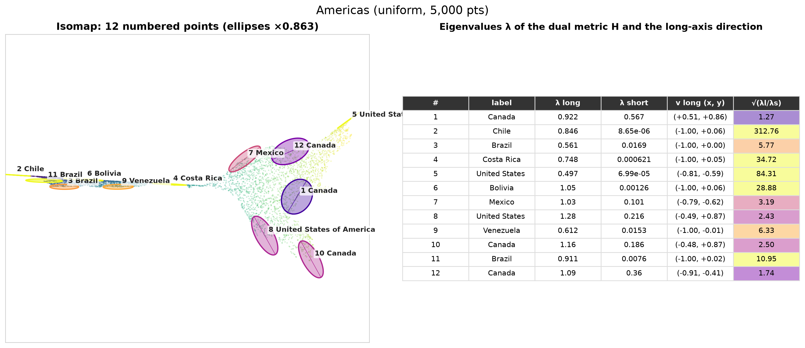 |
| 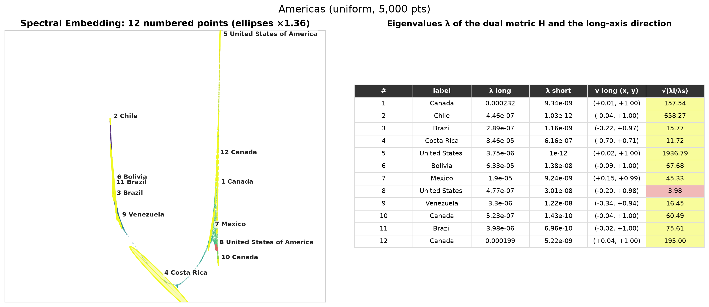 | 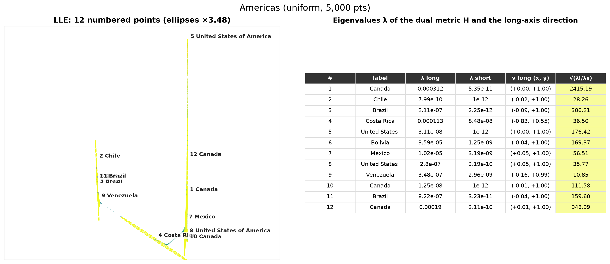 |
| 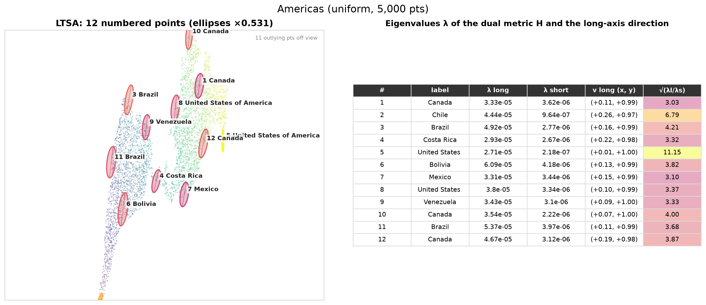 | |

**Balanced**

| | |
|---|---|
| 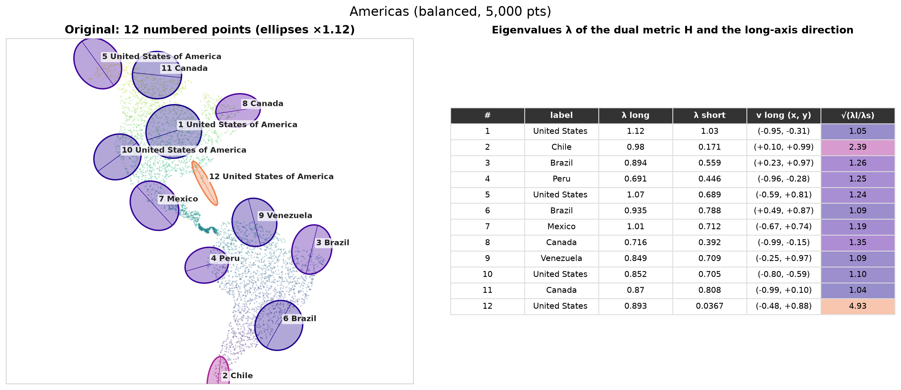 | 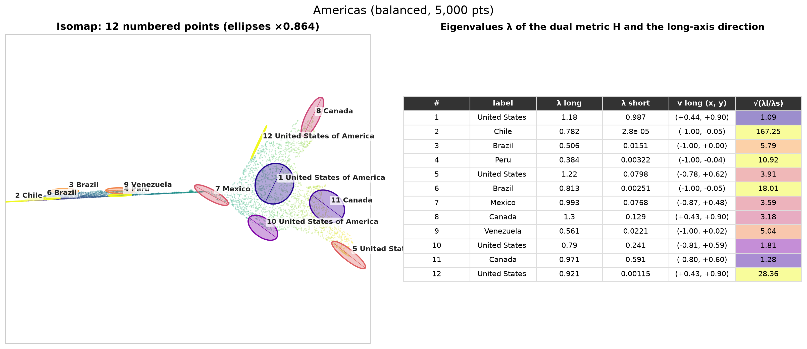 |
| 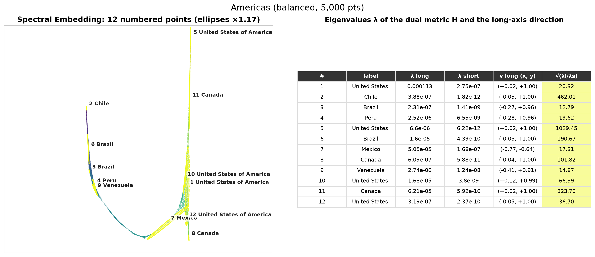 | 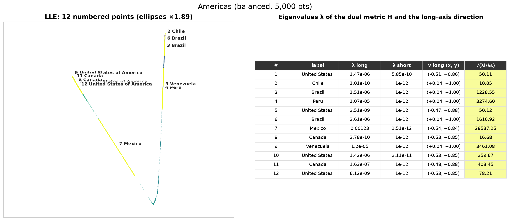 |
| 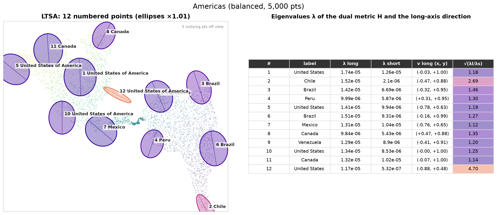 | |

## 5. Numbers (`summary.csv`)

| Algorithm | median ratio (uniform) | median ratio (balanced) | ratio > 2 (uniform / balanced) | area-scale spread p90/p10 (uniform / balanced) |
|---|---:|---:|---:|---:|
| Original (noise floor) | 1.08 | 1.09 | 0.5% / 3% | 1.40 / 1.63 |
| Isomap | 3.65 | 6.71 | 59% / 64% | 32.8 / 36.8 |
| Spectral Embedding | 33.7 | 24.9 | 100% / 100% | 56.2 / 58.9 |
| LLE | 118 | 398 | 100% / 99% | 147 / 1474 |
| LTSA | 3.75 | **1.18** | 100% / **3%** | **1.40 / 1.63** |

Per-point values: [uniform](../../results/americas/uniform_5000/riemannian/samples.csv) ·
[balanced](../../results/americas/balanced_5000/riemannian/samples.csv).

**Conclusion.** Bottlenecks break methods that rely on global geodesics (Isomap) or on
the low eigenvectors of the graph (Spectral Embedding, LLE). These methods then spend
both embedding dimensions on the long north–south axis. Adding points to the isthmus
(balanced) does **not** help them, and it makes LLE worse. It does let LTSA recover a
near-isometric map. How the data is sampled changes the result as much as the choice
of algorithm.
