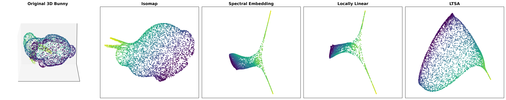
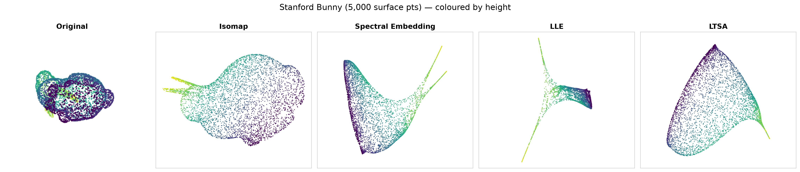
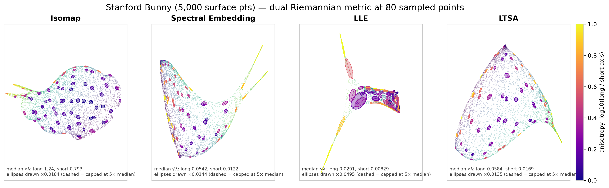
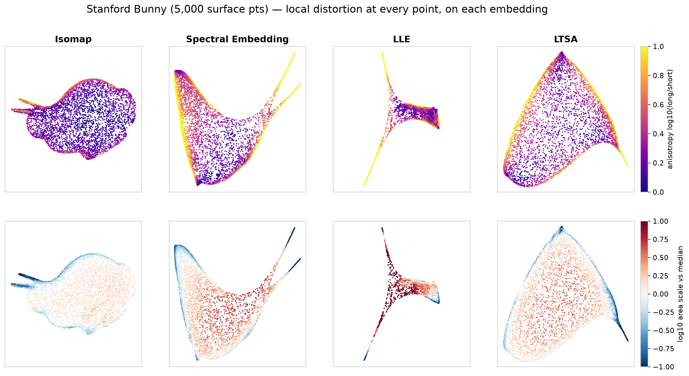
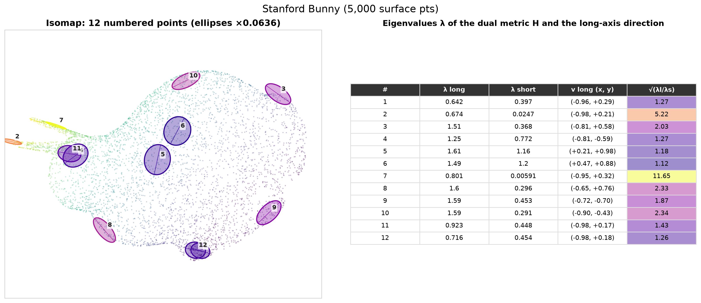
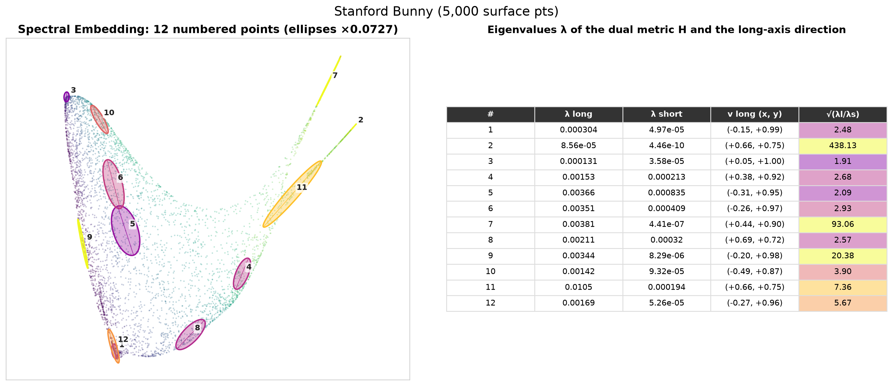
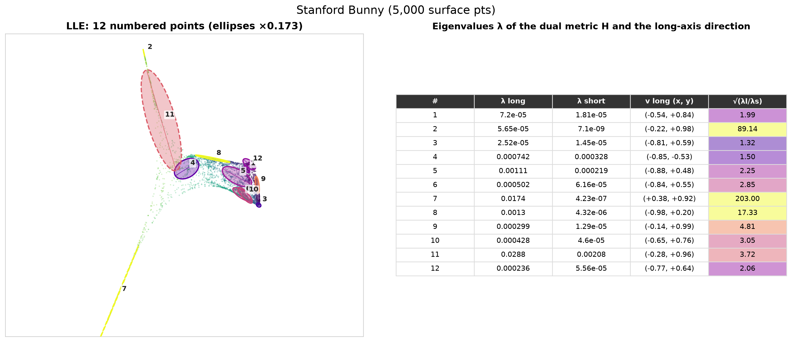
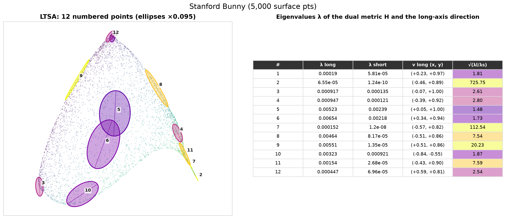

# Stanford Bunny

5,000 points sampled uniformly by area on the surface of the Stanford Bunny mesh,
centred and scaled into a unit box. The surface is 2D but curved and closed, with
two thin ears. A closed surface **cannot** be flattened into the plane without
distortion, so the question is *where* each method puts the distortion.

[← all results](README.md)

## 1. First-pass comparison (`run_bunny_benchmark.py`)

The 3D bunny (coloured by height) and the four embeddings.

- **Isomap** gives a flattened bunny silhouette. Body and head are one disk, and the
  **ears stick out as two separate prongs** on the left.
- **Spectral Embedding** and **LLE** produce a three-armed "Y": the body becomes a
  dense wedge and each ear becomes a long, thin arm.
- **LTSA** gives a rounded heart shape. Both ears merge into a single spike on the
  right.

Individual panels: [isomap](../../results/bunny/isomap.png) ·
[spectral](../../results/bunny/spectral_embedding.png) ·
[LLE](../../results/bunny/locally_linear.png) · [LTSA](../../results/bunny/ltsa.png)

## 2. Embeddings with corrected settings

Same layout from `riemannian_metric.py` (radius 0.07, `lobpcg` solver for Spectral).
Isomap and LTSA look the same as in the first pass. Spectral Embedding now looks
like a skewed triangle with the two ears as separate thin spikes. LLE is still a "Y".

## 3. Dual Riemannian metric ellipses

There is no "Original" panel here: the input is 3D, so the identity check does not
apply.

- **Isomap**: round ellipses in the body, flattened ones around the rim, and yellow
  needles along the ears. Distance *along* each ear is kept, but its width is
  squashed.
- **Spectral Embedding**: thin ellipses all along the left edge and the ears, rounder
  ones in the body. A lot of the surface is squeezed into the boundary.
- **LLE**: huge, very anisotropic ellipses in the arms of the "Y", next to tiny,
  overlapping ones packed into the dense body wedge. This is the largest change in
  size between regions of any method.
- **LTSA**: round in the interior, needles along the whole outer boundary and the ear
  spike.

## 4. Distortion at every point, on each embedding

The data is 3D, so each point is coloured at its position in the embedding.

- In **every** method the stretch ratio (top) is highest at the ears and at the
  boundary of the flattened region (yellow), and lowest in the interior (purple).
  This is the region where the closed surface had to be "cut open".
- The area scale (bottom) shows the opposite: the interior is enlarged (red) and the
  boundary and ears are shrunk (blue). Isomap has the mildest colours: its area varies
  by 5× (p90/p10), compared with 20–50× for the others.

## 5. Point-by-point detail

The same 12 points in each embedding (no labels; numbers match across figures).

| | |
|---|---|
|  |  |
|  |  |

For example, in Isomap the points on the ears (#2, #7) have stretch ratios of 5 and
12, while the points on the body (#1, #4–#6, #12) are 1.1–1.3.

## 6. Numbers (`summary.csv`)

| Algorithm | median stretch ratio | 90th pct ratio | share of points with ratio > 2 | area-scale spread (p90/p10) |
|---|---:|---:|---:|---:|
| Isomap | **1.55** | **3.71** | **32%** | **5.1** |
| Spectral Embedding | 3.42 | 18.8 | 79% | 20.3 |
| LLE | 2.98 | 14.6 | 78% | 49.2 |
| LTSA | 2.88 | 14.6 | 70% | 50.9 |

Per-point values for all 80 samples: [`samples.csv`](../../results/bunny/riemannian/samples.csv).

**Conclusion.** On a curved, closed surface no method can be isometric. All four put
their distortion in the same places: the thin ears and the rim where the surface is
cut open. Isomap distorts least overall. LLE and LTSA keep the interior fairly
isotropic but vary area by about 50×. With the metric you can **find** these regions,
which are exactly the ones you shouldn't trust in a 2D plot.
