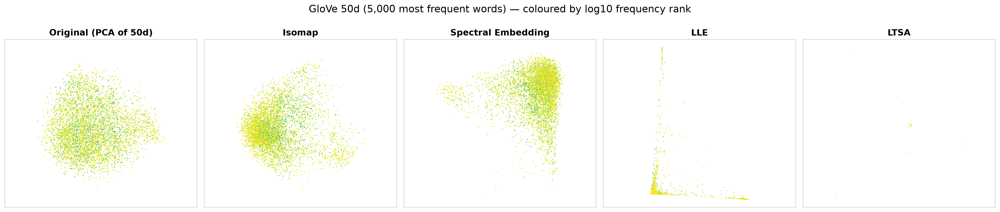
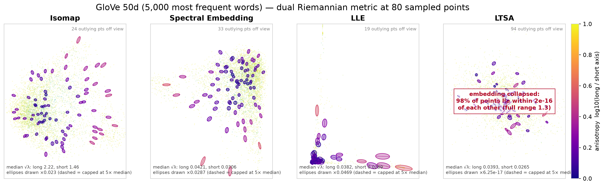
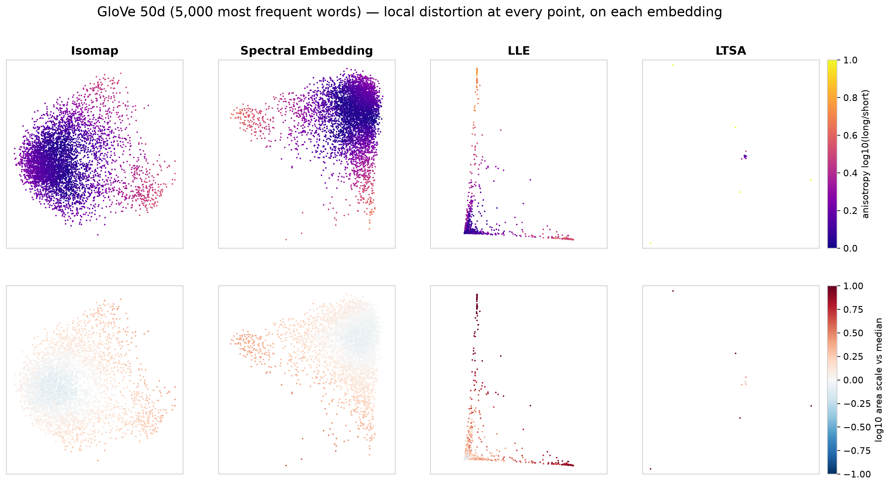
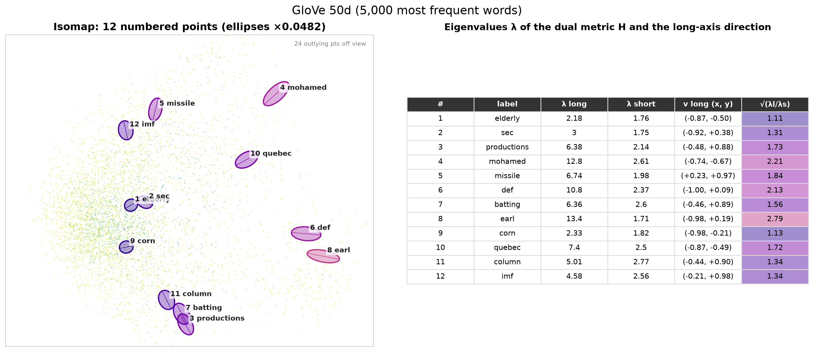
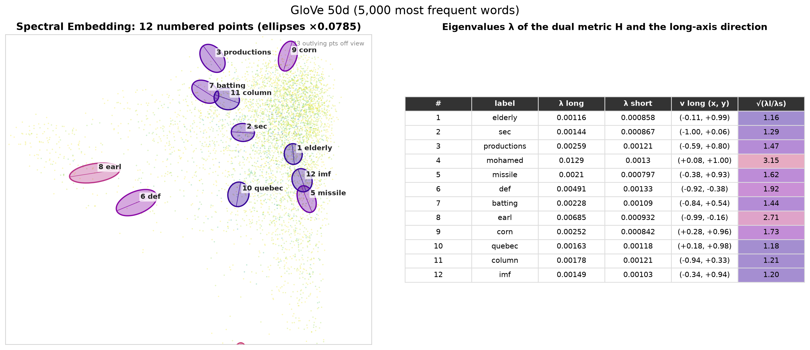
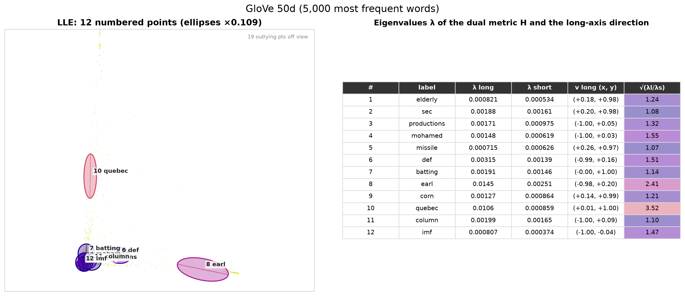
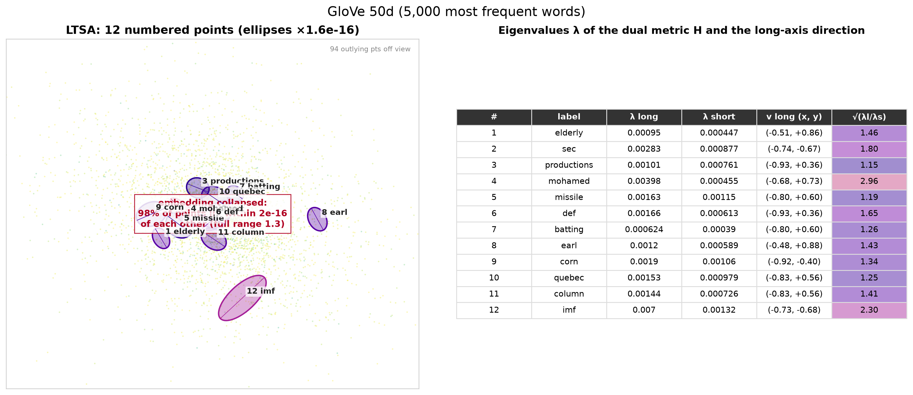

# GloVe word vectors

The 5,000 most frequent purely alphabetic words in GloVe 6B (50 dimensions),
L2-normalised so that they lie on the unit sphere. Unlike the other datasets, the
"true" geometry is unknown and almost certainly has **many more than 2 intrinsic
dimensions**. Every 2D embedding is therefore a projection, and `H` describes only the
2D slice each method keeps.

Points are coloured by `log10(frequency rank)`: dark = very common words, yellow =
rarer.

[← all results](README.md)

## 1. Embeddings

The first panel is a PCA projection of the 50D input, for reference.

- **PCA** gives one round blob with no visible structure.
- **Isomap** shows a dense core plus two sparser lobes. The right-hand lobe holds
  **personal names** (carlos, daniel, barbara, rodriguez…). The upper lobe holds
  **conflict and politics** words (taliban, troops, refugees, musharraf, yeltsin…).
- **Spectral Embedding** separates a cluster of **first names and surnames** on the
  left (john, david, smith, jones…). Its lower arm holds **Middle-East conflict**
  vocabulary (israeli, gaza, hamas, baghdad, militants…).
- **LLE** pushes almost all words into one corner. Two thin arms carry small groups,
  e.g. US **places and sports teams** (ohio, pittsburgh, yankees, dodgers, nba…).
- **LTSA collapses**: 98% of the words land on a single point (spread about
  1e-16), and about 94 scattered words make up the rest of the plot. In 50D, the
  local tangent-space alignment problem is degenerate with k = 20. (megaman's ARPACK
  solver also failed outright, so the dense solver was used.)

## 2. Dual Riemannian metric ellipses

- **Isomap / Spectral Embedding**: ellipses in the dense core are fairly round
  (purple). The lobes and arms (names, conflict words) have more elongated ellipses
  (pink/red): these semantic clusters are stretched in one direction more than the
  core.
- **LLE**: tightly packed ellipses at the corner, with larger, stretched ones along the
  arms.
- **LTSA**: the panel is zoomed into the collapsed point, and the red box warns that
  the ellipses are not meaningful there.

The low stretch ratios here (medians 1.2–1.4) do **not** mean the embeddings are
faithful. A 2D embedding of high-dimensional data can look locally round because the
Laplacian "averages" over the many dimensions that were dropped.

## 3. Distortion at every point, on each embedding

- **Isomap**: the core is isotropic and slightly shrunk (blue). The name and conflict
  lobes are more anisotropic and slightly enlarged (red), so the embedding stretches
  them out.
- **Spectral Embedding**: the same picture. The name cluster on the left is the most
  anisotropic region.
- **LLE**: the arms are strongly enlarged (dark red) compared with the dense corner.

## 4. Point-by-point detail

The same 12 words in each embedding, with their eigenvalues and eigenvectors.

| | |
|---|---|
|  |  |
|  |  |

In Isomap, words in the core such as *elderly*, *corn* and *sec* have ratios of 1.1–1.3.
Words in the lobes, such as *earl*, *mohamed* and *def*, have ratios of 2.1–2.8.

## 5. Numbers (`summary.csv`)

| Algorithm | median stretch ratio | 90th pct ratio | share of points with ratio > 2 | area-scale spread (p90/p10) |
|---|---:|---:|---:|---:|
| Isomap | 1.36 | 2.15 | 12% | 2.0 |
| Spectral Embedding | 1.32 | 2.14 | 12% | **1.9** |
| LLE | **1.19** | **1.74** | **7%** | 4.3 |
| LTSA | collapsed | – | – | – |

Per-point values (with the word for each point): [`samples.csv`](../../results/glove/riemannian/samples.csv).

**Conclusion and next steps.** Isomap and Spectral Embedding find interpretable
semantic structure (names, geopolitics) in 2D, and the metric shows these clusters are
locally stretched compared with the core. LTSA (and partly LLE) break down in 50D. To
get trustworthy distortion numbers here, the next step is to **estimate the intrinsic
dimension** and embed into that many dimensions (megaman supports `n_components > 2`
and `RiemannMetric` with `n_dim = d`). Only after that should the result be projected
to 2D for plotting.
